

<picture>
  <source media="(prefers-color-scheme: light)" srcset="./assets/profile-banner-light.svg">
  
</picture>
 

  

  
<picture><source media="(prefers-color-scheme: light)" srcset="./assets/metrics-light.svg">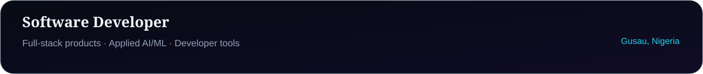</picture>
  
<picture><source media="(prefers-color-scheme: light)" srcset="./assets/terminal-light.svg"></picture>
 
<picture><source media="(prefers-color-scheme: light)" srcset="./assets/divider-light.svg"></picture>

## About
I’m **Sadiq Abdullahi**, a Software Developer and founder of **[Devlify Marketplace](https://devlify.com.ng)**. I build web and mobile applications, business platforms, practical AI/ML features, and developer tools—turning real-world problems into dependable digital products.

My work spans full-stack product development, APIs, databases, automation, and deployment. I care about software that is useful, maintainable, and thoughtfully delivered.

## Engineering Focus
I focus on dependable full-stack products, applied AI/ML, developer tools, and reliable delivery.

  <picture><source media="(prefers-color-scheme: light)" srcset="./assets/engineering-focus-light.svg">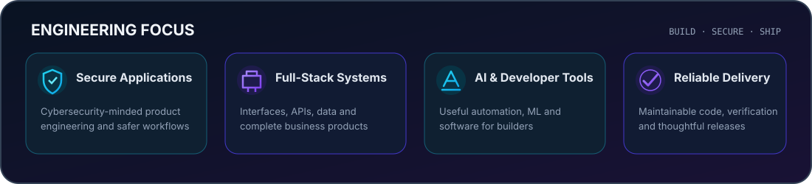</picture>

<picture><source media="(prefers-color-scheme: light)" srcset="./assets/divider-light.svg"></picture>

## Selected Projects
### Production systems

<picture><source media="(prefers-color-scheme: light)" srcset="./assets/project-atp-light.svg"></picture>
<picture><source media="(prefers-color-scheme: light)" srcset="./assets/project-production-system-light.svg">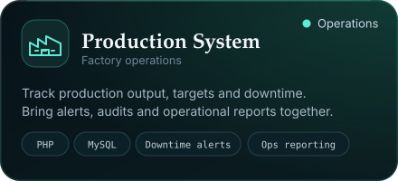</picture>
<picture><source media="(prefers-color-scheme: light)" srcset="./assets/project-remotebridge-light.svg">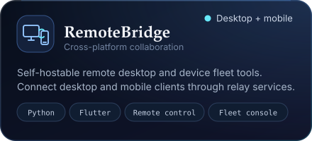</picture>
<picture><source media="(prefers-color-scheme: light)" srcset="./assets/project-murabaha-pos-light.svg"></picture>
<picture><source media="(prefers-color-scheme: light)" srcset="./assets/project-fugusau-light.svg"></picture>
<picture><source media="(prefers-color-scheme: light)" srcset="./assets/project-caliphate-light.svg"></picture>
<picture><source media="(prefers-color-scheme: light)" srcset="./assets/project-gomnati-light.svg"></picture>
<picture><source media="(prefers-color-scheme: light)" srcset="./assets/project-nexuswhitelist-light.svg"></picture>

### Developer tools & product platforms

<picture><source media="(prefers-color-scheme: light)" srcset="./assets/project-nexus-ide-light.png">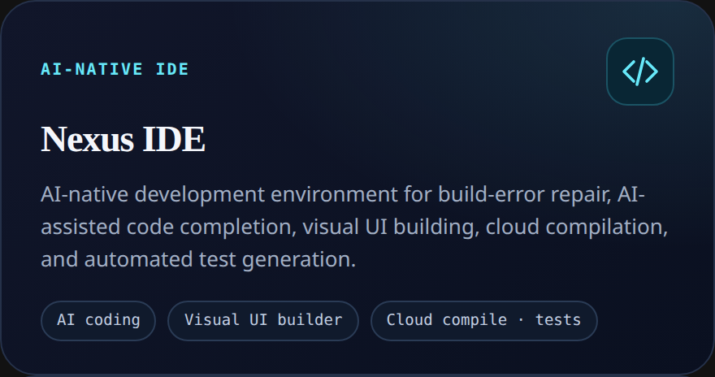</picture>
<picture><source media="(prefers-color-scheme: light)" srcset="./assets/project-naijabiz-light.png">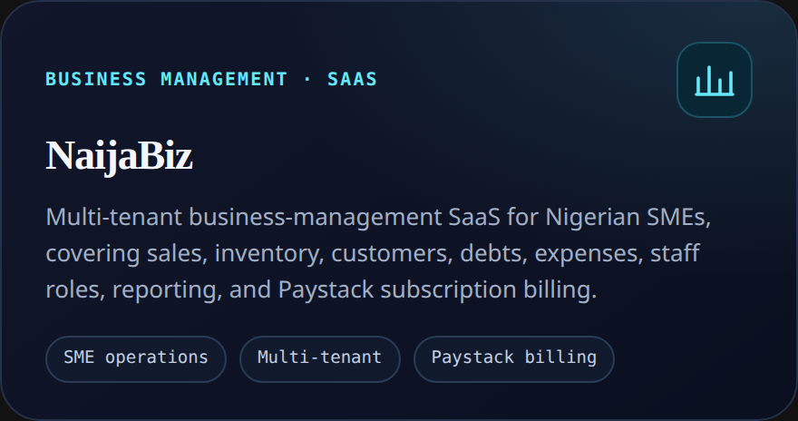</picture>
<picture><source media="(prefers-color-scheme: light)" srcset="./assets/project-amanah-land-light.png">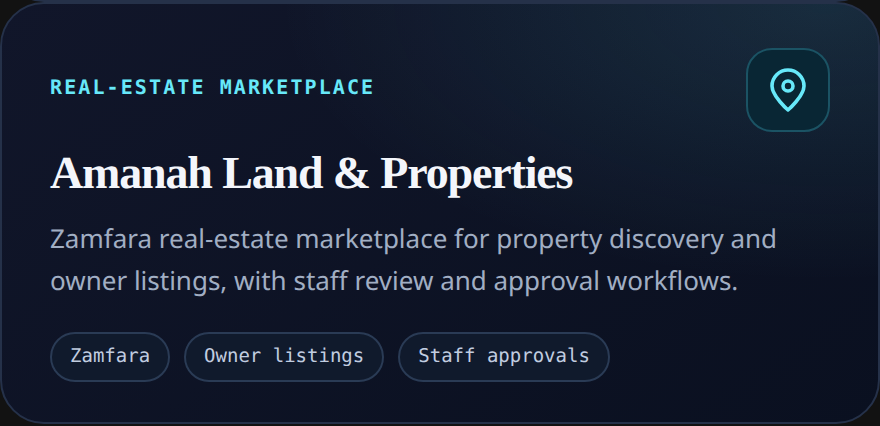</picture>

Explore more work in <a href="https://devsadeeq-portfolio.vercel.app/projects">the project portfolio</a>.

### Devlify open source

<a href="https://github.com/devlify-marketplace/devlify-tensor"><picture><source media="(prefers-color-scheme: light)" srcset="./assets/project-tensor-light.svg"></picture></a>
<a href="https://github.com/devlify-marketplace/devlify-decompiler"><picture><source media="(prefers-color-scheme: light)" srcset="./assets/project-decompiler-light.svg"></picture></a>
<a href="https://github.com/devlify-marketplace/devlify-skills"><picture><source media="(prefers-color-scheme: light)" srcset="./assets/project-skills-light.svg"></picture></a>
<a href="https://devsadeeq-portfolio.vercel.app/projects"><picture><source media="(prefers-color-scheme: light)" srcset="./assets/project-more-light.svg"></picture></a>

<picture><source media="(prefers-color-scheme: light)" srcset="./assets/divider-light.svg"></picture>

  <picture><source media="(prefers-color-scheme: light)" srcset="./assets/pipeline-light.svg">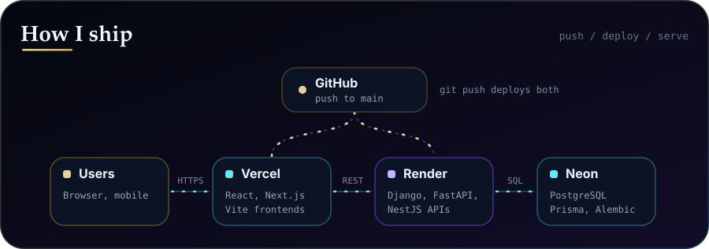</picture>

<picture><source media="(prefers-color-scheme: light)" srcset="./assets/divider-light.svg"></picture>

## Technology Stack

  <picture><source media="(prefers-color-scheme: light)" srcset="./assets/tech-stack-light.svg">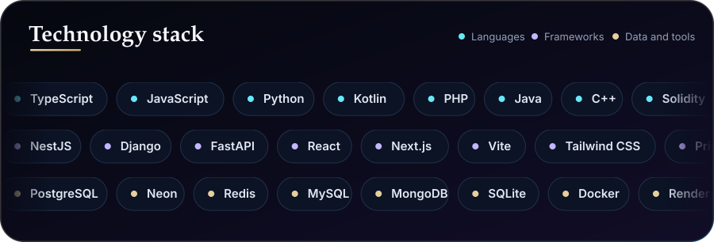</picture>

<picture><source media="(prefers-color-scheme: light)" srcset="./assets/divider-light.svg"></picture>

## Engineering Principles
- **Build for real use:** connect interfaces, APIs, data, and operational needs into complete products.
- **Keep systems understandable:** favor clear structure, maintainable code, and practical documentation.
- **Use ML responsibly:** make model scope and limitations clear, and keep evaluation grounded in data.
- **Deliver with care:** test important paths and verify changes before release.

## GitHub Activity

<picture>
  <source media="(prefers-color-scheme: dark)" srcset="https://raw.githubusercontent.com/devlify-marketplace/devlify-marketplace/output/github-snake-dark.svg" />
  <source media="(prefers-color-scheme: light)" srcset="https://raw.githubusercontent.com/devlify-marketplace/devlify-marketplace/output/github-snake.svg" />
  
</picture>
  
<picture><source media="(prefers-color-scheme: light)" srcset="./assets/stats-light.svg"></picture>
<picture><source media="(prefers-color-scheme: light)" srcset="./assets/langs-light.svg"></picture>

### Recently active
<!-- RECENT:START -->
- [**8-fake-news-detection-on-nigerian-social-media-using-bidirectional-lstm**](https://github.com/devlify-marketplace/8-fake-news-detection-on-nigerian-social-media-using-bidirectional-lstm) `Python`: 8 - Fake News Detection on Nigerian Social Media Using Bidirectional LSTM
- [**7-tuberculosis-detection-from-chest-x-rays-using-densenet-and-resnet**](https://github.com/devlify-marketplace/7-tuberculosis-detection-from-chest-x-rays-using-densenet-and-resnet) `Python`: 7 - Tuberculosis Detection from Chest X-Rays Using DenseNet and ResNet
- [**6-malaria-parasite-detection-from-blood-smear-images-using-a-convolutional-neural-network**](https://github.com/devlify-marketplace/6-malaria-parasite-detection-from-blood-smear-images-using-a-convolutional-neural-network) `Python`: 6 - Malaria Parasite Detection from Blood Smear Images Using a Convolutional Neural Network
- [**5-hausa-to-english-neural-machine-translation-using-a-sequence-to-sequence-transformer**](https://github.com/devlify-marketplace/5-hausa-to-english-neural-machine-translation-using-a-sequence-to-sequence-transformer) `Python`: 5 - Hausa-to-English Neural Machine Translation Using a Sequence-to-Sequence Transformer
- [**4-sentiment-analysis-for-hausa-yoruba-and-igbo-using-a-fine-tuned-bert-model**](https://github.com/devlify-marketplace/4-sentiment-analysis-for-hausa-yoruba-and-igbo-using-a-fine-tuned-bert-model) `Python`: 4 - Sentiment Analysis for Hausa, Yoruba and Igbo Using a Fine-Tuned BERT Model
<!-- RECENT:END -->

<picture><source media="(prefers-color-scheme: light)" srcset="./assets/divider-light.svg"></picture>

  <a href="https://devlify.com.ng"><picture><source media="(prefers-color-scheme: light)" srcset="./assets/contact-light.svg"></picture></a>

## Connect
- **Website:** [devlify.com.ng](https://devlify.com.ng)
- **LinkedIn:** [Sadiq Abdullahi](https://www.linkedin.com/in/sadiq-abdullahi-970840349)
- **Email:** [sadiq@devlify.com.ng](mailto:sadiq@devlify.com.ng)
- **ORCID:** [0009-0001-8535-0768](https://orcid.org/0009-0001-8535-0768)

 

  <picture><source media="(prefers-color-scheme: light)" srcset="./assets/footer-light.svg"></picture>

