 

  

  

  

 

## About

I’m **Sadiq Abdullahi**, a Software Developer and the founder of **[Devlify](https://devlify.com.ng)**. I build secure web and mobile applications, business platforms, AI/ML solutions, and developer tools—turning practical problems into dependable digital products.

My work spans product development, application security, APIs, databases, automation, and deployment. I’m especially interested in software that is useful in the real world, safe to operate, and maintainable as it grows.

  

## Selected Projects

The portfolio also spans PHP, MySQL, JavaScript, Bootstrap, Next.js, React, Python, Flask, machine learning, and Chart.js. <a href="https://devsadeeq-portfolio.vercel.app/projects">Explore all projects</a>

## Technology Stack

  

## Engineering Principles

- **Security is foundational:** design trusted boundaries and secure application flows from the start.
- **Build for real use:** connect interfaces, APIs, data, and operational needs into complete products.
- **Keep systems understandable:** favor clear structure, maintainable code, and practical documentation.
- **Deliver with care:** test important paths and verify changes before release.

## GitHub Activity

 

## Connect

- **Website:** [devlify.com.ng](https://devlify.com.ng)
- **LinkedIn:** [Sadiq Abdullahi](https://www.linkedin.com/in/sadiq-abdullahi-970840349)
- **Email:** [devsadeeqlabs@gmail.com](mailto:devsadeeqlabs@gmail.com)
- **ORCID:** [0009-0001-8535-0768](https://orcid.org/0009-0001-8535-0768)

 

  

